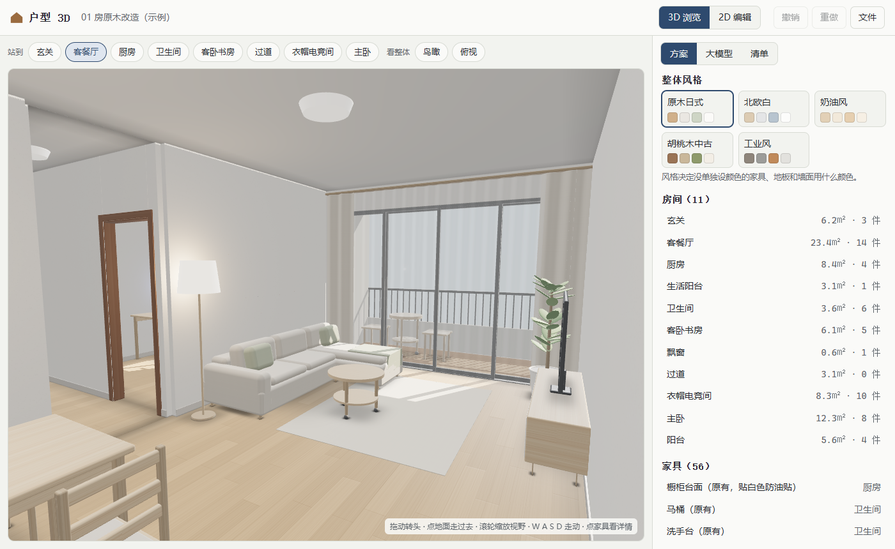
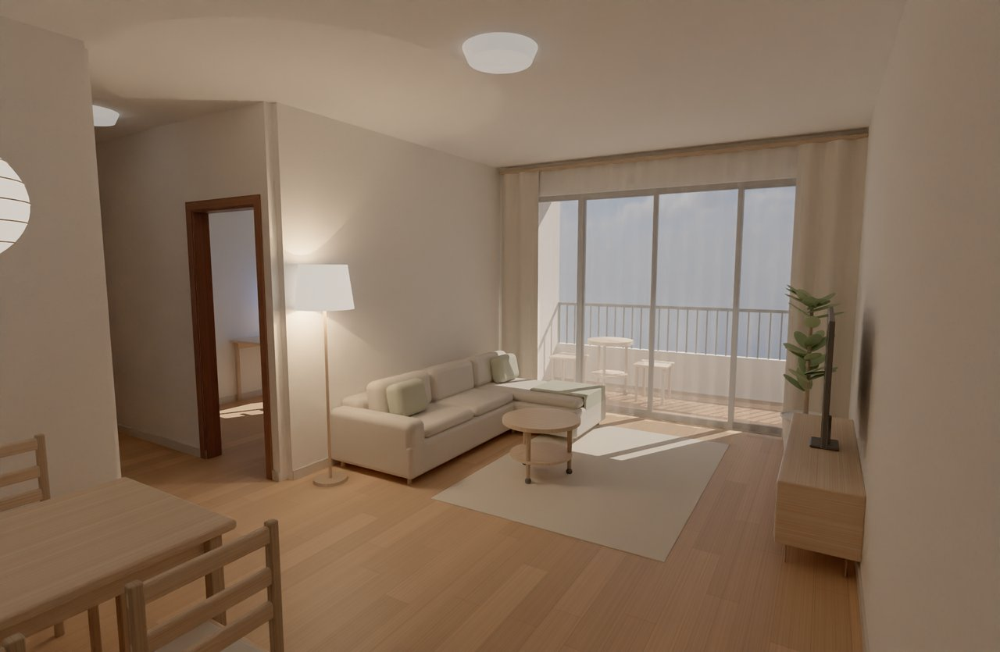
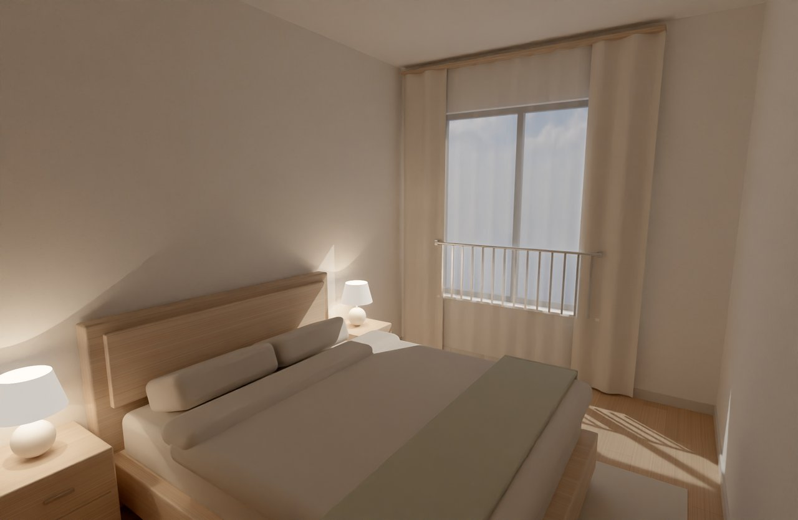
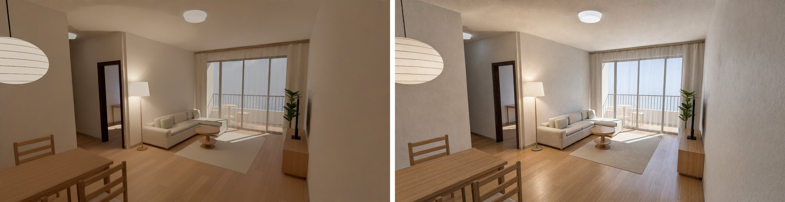

# 户型 3D

上传自家的户型图，自动识别出墙、门窗和房间，生成一个能走进去转头看的 3D 模型；一键按房间用途摆好家具，再用一句话让大模型按你的想法改、换风格配色、列采购清单和预算。

不用注册，不用装软件，数据都存在你自己的浏览器里。

在线使用：<https://yanruoqaq.github.io/floorplan-3d/> · 家具库：<https://yanruoqaq.github.io/floorplan-3d/gallery.html>



## 能做什么

| | |
|---|---|
| **从户型图生成** | 上传户型图，框出自家那一户（整张图只有一户就不用框），自动识别墙、门窗和房间，比例按图上的尺寸数字算，一般不用手动标定（贝壳 VR 图这类尺寸本身对不上的，要用“标定比例”核对）。识别结果是草稿，浮在底图上方便对照修改，读错的尺寸数字可以改了重算。要用能看图的大模型（默认通义千问 qwen3-vl-plus）。 |
| **描户型** | 也可以自己描：上传户型图当底图，点两个点、输入实际长度来标定比例（手机拍的图横竖比例不一样，可以分别标定）。画墙时自动吸附端点、对齐、拉成横平竖直；在墙上点一下放门窗；拖一个框或逐点围出房间。 |
| **自动出 3D** | 墙、门（开着的门扇）、推拉门、窗、窗台、地板、天花板、踢脚线全部按数据生成。第一人称走动（点地面走过去、WASD）、鸟瞰、俯视，每个房间自动找一个“站在墙角看对角”的视角。 |
| **出效果图** | 把当前视角渲染成接近照片的效果图，或者站在房间里出一张 720 全景。用路径追踪算光线在屋里的多次反弹，用你自己电脑的显卡在浏览器里算，不上传任何东西；一张十几到几十秒。需要支持 WebGPU 的浏览器（电脑上的 Chrome、Edge）。出完可以点“AI 精修”，用你的通义千问 Key 把效果图做成照片质感的示意图。 |
| **家具** | 38 种参数化家具（床、沙发、柜子、灯、窗帘、厨卫……），在属性面板里尺寸随便改，外形跟着变。5 套整体风格一键切换。 |
| **一键布置** | 选一套风格，程序按房间用途摆好常用家具：床和床头柜、衣柜、沙发和电视柜、餐桌椅、灯、地毯、窗帘，厨卫和阳台也有；保证不挡门窗、不重叠，不用大模型、不花钱。 |
| **大模型布置** | 在一键布置的基础上说想法：“主卧加梳妆台，预算两万以内”——大模型给出修改清单，程序先检查出界、重叠、挡门，你确认后才改，改完能撤销。 |
| **采购清单** | 按房间汇总价格和预算；大模型估的价格单独标出“未核实”。 |


“出效果图”渲染的示例客餐厅和主卧（1920 像素宽，每个像素采样 128 次加降噪；2026-11-25 用 RX 7800 XT 显卡各约 40 秒）：

| | |
|---|---|
|  |  |

左：效果图；右：AI 精修（qwen-image-2.1-pro，13 秒）。房间结构、家具位置和数量保住了，材质和光影更像照片；但它是图像模型重新画的，细节可能和方案不一致，只当示意图。



## 使用步骤

1. **填 Key**：右侧“大模型”面板选“通义千问（阿里云百炼）”，填 API Key（识别户型图要用它的识图模型）。只想自己描图、一键布置的话可以不填。
2. **从户型图生成**：点右上角“从户型图生成”，选户型图。拖一个框框住你家那一户（连阳台），整张图只有你家就点“整张图就是一户”。等二三十秒，墙、门窗和房间出来了。
3. **检查草稿**：识别结果浮在底图上。对照看一遍：墙拖端点改，门窗不对删掉重放，房间名和类型在右侧改。左上角会列出拿不准的地方（比如某个尺寸数字和别的对不上），读错的尺寸数字可以直接改，点“重算”。
4. **布置家具**：点“下一步：布置家具”，选风格，开始布置。想法写在框里（比如“次卧做书房”），会交给大模型在自动布置的基础上改，并顺便估价格。
5. **看 3D、出效果图**：拖动转头，点地面走过去，点家具看详情。想要一张好看的图，点视角栏右边的“出效果图”。
6. **对清单**：右侧“清单”面板看合计和预算，价格可以直接改。
7. **保存和分享**：方案会自动存在浏览器里。当前方案有内容时，新建、打开示例、导入会先问一句，并把原来的方案留一份，在“文件 → 恢复上一个方案”找回。“文件 → 导出 JSON”可以备份，或者发给别人，对方用“导入 JSON”打开。

想先看看效果：“文件 → 打开示例：01 房”，是一套三室两厅的软装方案。

## 接入大模型

在右侧“大模型”面板选厂商、填 API Key，每家的 Key 分开存，切换厂商不会把这家的 Key 发给那家。用的是各家通用的 OpenAI 兼容接口。识别户型图和 AI 精修会自动用填过 Key、有对应模型的那家：比如对话用 DeepSeek，识图和精修用通义千问。2026-11-24 检查过，下面几家的接口允许网页直接跨域调用：

| 厂商 | 对话模型（默认） | 识图模型（默认） |
|---|---|---|
| DeepSeek | deepseek-chat | 无 |
| 通义千问（阿里云百炼） | qwen-plus | qwen3-vl-plus |
| Kimi（月之暗面） | kimi-latest | kimi-latest |
| 豆包（火山方舟） | 自己填 | 自己填 |
| OpenAI | gpt-4o-mini | gpt-4o-mini |
| 其他 OpenAI 兼容接口 | 自己填 | 自己填 |

出效果图里的“AI 精修”目前只接了通义千问的图像编辑模型（默认 qwen-image-2.1-pro，按 2026-11 的百炼价格约 0.25 元/张；qwen-image-2.1-turbo 约 0.1 元/张），在模型设置的“图像模型”里改。

模型名会更新，默认值可能过时（2026-11-24 通义千问的 qwen-vl-max 已经调不通，默认识图模型换成了 qwen3-vl-plus）。点“获取模型列表”可以从厂商那里读当前能用的模型。智谱的接口不允许浏览器直接调用，用不了。

**数据去了哪里**：Key 只保存在你这个浏览器里（localStorage）。提问时，户型数据（墙、房间、家具，不含底图）和你说的话由浏览器**直接**发给你选的厂商；这个网站是纯静态页面，没有服务器，不经手任何数据。识别户型图时会把整张户型图（读边上的尺寸数字）和你框出的那一户（画上了程序给房间、门窗编的号）发给厂商，墙的位置在你的浏览器里从图片像素找；AI 精修时会把那张效果图发给阿里云百炼。“出效果图”本身在你的电脑上算，不发给任何人。调用按厂商价格计费。在公用电脑上用完请点“清除所有 Key”。

**大模型能改什么**：只能增删改家具、让程序自动布置某个房间、换地板墙面颜色和整体风格、加清单项，动不了墙和门窗。它返回的是结构化的修改指令（见 `src/model/ops.ts`），程序校验后列给你看，有摆放问题会标出来，你点“应用”才生效。

**画面质量不靠大模型**：家具外形、材质、光照都是程序里的固定模板，大模型不画 3D 也不写代码，只能选家具类型、木色、风格这些固定选项。它给的尺寸限制在每种家具的常见范围内（比如床头柜高 35–70 cm），超出的改到范围边上并提醒你；颜色只能从布艺、地板、墙面三个色板里选名字（色板见 `src/model/themes.ts`），你要的颜色色板里没有时，它会选最接近的。这些限制只管大模型，你在属性面板里手动改尺寸和颜色不受限。

## 数据格式

一套方案就是一个 JSON 文件：墙（两个端点 + 墙厚 + 门窗洞口）、房间（多边形 + 地面墙面做法）、家具（类型、中心位置、朝向、尺寸、颜色、价格）、清单项。字段说明见 [docs/schema.md](docs/schema.md)，完整例子见 [examples/01-room.json](examples/01-room.json)。

## 本地开发

需要 Node.js 20.19 以上（或 22.12 以上）。

```bash
npm ci            # 按 package-lock.json 装依赖（ci = 严格按锁定版本装，比 npm install 更可复现）
npm run dev       # 开发服务器，浏览器打开 http://localhost:5173 ，改代码自动刷新
npm test          # 跑全部单元测试（Vitest）
npm run build     # 类型检查 + 打包到 dist/，就是部署到 GitHub Pages 的内容
npm run preview   # 本地预览打包结果
```

推送到 `main` 分支后，GitHub Actions（`.github/workflows/pages.yml`）会自动跑测试、打包、发布到 GitHub Pages。

### 代码结构

```
src/
  model/          数据和纯逻辑，不依赖 three.js，全部有单元测试
    schema.ts       house.json 的格式定义（zod），类型、校验、默认值都从这里来
    catalog.ts      家具目录：类型、中文名、默认尺寸、变体
    geometry.ts     多边形、墙体切段、家具占地、能不能走、自动视角
    ops.ts          大模型的修改指令：格式、套用、摆放检查
    furnish.ts      一键布置：按房间用途和门窗位置摆常用家具（规则，不用大模型）
    raster.ts       户型图识别：从图片像素里找墙（实心、空心双线）、门窗洞口、房间
    scale.ts        户型图识别：比例（尺寸链对墙中线、总尺寸对外墙、图上印着的面积，互相核对）
    draft.ts        户型图识别：检查尺寸数字、和墙对上；像素里围不出房间时按模型给的房间出草稿
    fuse.ts         户型图识别：墙段和洞口连成墙、按编号把模型认出的房间名和门窗类型对上
    evaluate.ts     户型图识别的评测：和标准答案比墙、门窗、房间
    budget.ts       采购清单汇总
    store.ts        当前方案、撤销重做、自动保存
    themes.ts       5 套整体风格
  three/          3D
    textures.ts     程序生成的纹理（木纹、布纹、瓷砖……，不用图片文件）
    materials.ts    材质
    walls.ts        墙、门、窗
    rooms.ts        地面、天花板、墙角暗影
    furniture/      38 种家具的参数化外形
    scene.ts        把一份 House 变成场景
    viewer.ts       渲染、第一人称走动、鸟瞰、点选
    render.ts       出效果图：WebGPU 路径追踪 + 降噪（点按钮时才加载）
  editor/         二维描图编辑器（SVG）
  llm/            大模型：接口调用、提示词、户型图识别（读尺寸、认房间）、AI 精修
  ui/             右侧面板：方案、属性、大模型、清单；出效果图、布置家具对话框
public/render/    出效果图用的天空 HDRI 和降噪网络权重
tests/            单元测试（raster-real.test.ts 是真实户型图上的检测评测，图和答案在 local/ 里、不进仓库，没有就跳过）
tools/eval.html   户型图识别评测页（只在 npm run dev 时用，不打包）：读 local/eval/cases.json 里的测试图和标准答案
examples/         示例方案
```

### 为什么这样设计

- **纯前端，没有后端**：别人打开网址就能用，没有服务器成本，也不用替用户保管数据和 Key。代价是只能用允许浏览器直接调用的大模型厂商。
- **three.js**：网页 3D 最常用的库，电脑和手机浏览器都能跑。没用 React，因为界面只有几块面板，3D 和 SVG 都是直接操作的。
- **zod**：导入的 JSON 和大模型的回复都不可靠，要校验。一份定义同时给出 TypeScript 类型、运行时校验和报错信息。
- **大模型只发指令，不发整份方案**：整份方案太长，它也会顺手改坏墙。指令只有几种，每条都能检查；摆放用“靠哪面墙、在哪一段”“挨着哪件家具”“放在哪件上面”描述，坐标由程序算，比让它直接算坐标准。
- **尺寸有范围、颜色是选择题**：不同厂商、不同大小的模型水平差很多，让它自由填尺寸和色值，效果就看模型好坏（实测有模型把整屋地板设成接近纯白）。改成在范围内填、从色板里选，换哪个模型，尺寸和颜色都不会离谱；代价是色板外的颜色要自己手动调。
- **家具按尺寸拼出来**：没用真实商品的 3D 模型，所以能任意改尺寸，文件也小；枕头、被子、坐垫用“软包”件做出鼓起，柜子有独立门板、缝和金属拉手。2026-11-25 调研过免费可商用的写实模型：CC0 的现代款只有绿植、吊灯和少量摆件，其余多是要署名、要登录才能下载的 CC-BY 模型，风格也难统一，所以暂时都用参数化建模。
- **识别户型图：像素找墙，模型按编号认名字**：识图大模型认得出“这是主卧”“这是推拉门”，尺寸数字也读得对，但给不准位置——2026-11-25 实测让它直接报坐标，房间边界常差 0.3～1.2 m，连尺寸数字的位置都是编的；2026-11-26 在 10 张真实户型图上，让它报房间范围再按重叠对号入座，房间类型只对了 26/66。所以位置全由程序定：墙（图上最粗最黑的线，或空心双线）、门窗洞口、房间都在浏览器里从像素找；然后给找到的每个房间涂一层淡色、标上编号，每个门窗标上字母，模型只回答“几号是什么房间、哪个字母是什么门窗”（这种做法叫 Set-of-Mark）。比例用模型读到的尺寸数字去对找到的墙中线，只有总尺寸时对外墙跨度；模型报的房间面积要在“读尺寸”那次也抄到同样的数才算图上印着的——真实图里 6 张没写面积，模型照样报了。像素里一个房间都围不出来的图，退回让模型报房间范围，准度差，只当草稿。
- **一键布置用规则，个性化交给大模型**：大模型一次摆整套房子常漏东西、挡门挡窗，效果看模型好坏。规则摆法按房间类型、门窗位置逐件试候选位置，用和大模型同一套摆放检查把关，保证每个房间齐全、不挡门窗、不重叠；大模型在这个基础上按用户的想法增删改、估价格。
- **AI 精修只当示意图**：图像模型能让材质和光影更像照片，但它是重新画一遍，家具款式、细节甚至数量可能变，所以和方案、采购清单脱钩，界面上明确标出来。装修平台的做法也是先用 3D 锁住结构，再用 AI 美化。
- **浏览用实时渲染，出图用路径追踪**：装修平台也是这样分的。实时渲染（WebGL）每秒几十帧，适合走动和摆家具，但只算直射光，墙角不会变暗、颜色不会互相映，像游戏截图。路径追踪模拟光线多次反弹，接近照片，但一张要几十秒，所以只在点“出效果图”时算。商用平台在云端 GPU 上算；这里用 [three-gpu-pathtracer](https://github.com/gkjohnson/three-gpu-pathtracer) 在用户自己的显卡上算，不需要服务器，代价是速度取决于用户的电脑、要求浏览器支持 WebGPU。降噪用 Intel Open Image Denoise 的 WebGPU 版，每个像素采样几十次就能出干净的图。

## 局限

- 家具是参数化的简化模型，用来看布局、尺寸、动线和色调，没有真实商品的细节，和实物款式会有差别。
- 户型图识别是草稿，要对照底图检查。2026-11-26 用 qwen3-vl-plus 在 10 张网上找的真实户型图上实测（贝壳二手房、开发商彩色户型图、CAD 原始结构图、黑白线稿各几张；一次 17～28 秒）：
  - 比例：6 张和图上量出的真实比例差 3% 以内，1 张差 3.4%；差得多的 3 张是贝壳 VR 户型图（它的尺寸链自己就对不上，上下两排对同一段差 2.7%）和一张空心墙的 CAD 图，最多差 11%。识别完建议用“标定比例”量一段核对一下。
  - 房间类型：66 个房间对了 59 个（89%，原来的做法是 26 个）。错的 7 个：2 个没围出房间（入户花园、阳台，外沿没封口或只画了细线），3 个厨房认成了别的（其中一个是开放式厨房和餐厅连成了一片），2 个认错用途。
  - 有完整标准答案的 3 张：墙 18/18、18/20、17/20 落在真实位置 10 厘米以内；门窗找到 11/14、10/17、7/10，另有 7～11 个多出来的（衣柜门、家具线被当成门窗），要手动删。
  - 合成的干净户型图（按示例数据画的）：墙 21/24、房间 11/11、门窗 10/13。
  - 整栋楼的小图里每户只有两三百像素，建议框出自家那一户后放大看，或者自己描。
- 一键布置按常见户型的摆法，房间名字特别（比如“衣帽电竞间”）时按识别出的类型摆，可能不是你想要的；放不下的东西会在提示里说。
- 大模型给的价格是按常见价位估的，没有联网核实。
- 墙只能是直的，只支持一层。
- 编辑器按电脑设计；手机上可以看 3D 和清单，编辑不方便。
- 出效果图要浏览器支持 WebGPU：电脑上的 Chrome、Edge 可以，Firefox 目前只有 Windows 版默认支持。速度取决于显卡：上面的示例图用 RX 7800 XT 约 40 秒一张（标准清晰度约 15 秒），集成显卡会慢很多，手机没测过。第一次出图要下载约 4 MB（渲染程序、天空贴图和降噪权重）。
- AI 精修只支持通义千问，按张计费，结果是示意图（见上）；结果图由厂商保存约 24 小时，要留着请另存。

## 许可

MIT。示例 `examples/01-room.json` 是按一张公开的户型图手工换算的一户，加上一套软装方案（家具摆放和参考价格），不含户型图原图。

用到的第三方代码和资源：

| | 许可 |
|---|---|
| [three.js](https://threejs.org/)、[three-mesh-bvh](https://github.com/gkjohnson/three-mesh-bvh)、[three-gpu-pathtracer](https://github.com/gkjohnson/three-gpu-pathtracer)、[oidn-webgpu](https://github.com/pissang/oidn-webgpu)、[zod](https://zod.dev/) | MIT |
| 降噪网络权重 `public/render/rt_hdr_alb_nrm.tza`，来自 [Intel Open Image Denoise](https://github.com/RenderKit/oidn-weights) | Apache-2.0，原文见 `public/render/LICENSE-oidn-weights.txt` |
| 天空 HDRI `public/render/sky_1k.hdr`，来自 Poly Haven 的 [Kloofendal 48d Partly Cloudy (Pure Sky)](https://polyhaven.com/a/kloofendal_48d_partly_cloudy_puresky) | CC0 |
