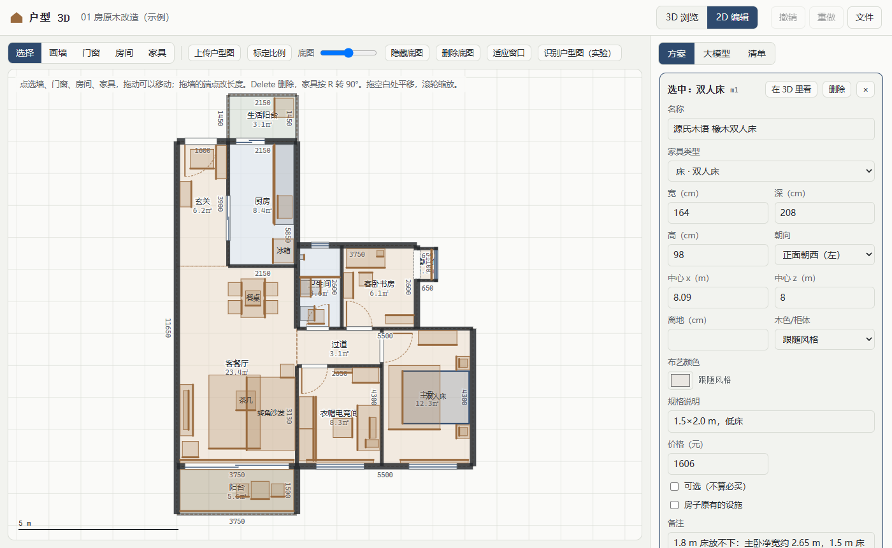

# 户型 3D

上传自家的户型图，在网页里描出墙、门窗和房间，自动生成一个能走进去转头看的 3D 模型；填上你自己的大模型 API Key，就能用一句话布置家具、换风格配色、列采购清单和预算。

不用注册，不用装软件，数据都存在你自己的浏览器里。

在线使用：<https://yanruoqaq.github.io/floorplan-3d/> · 家具库：<https://yanruoqaq.github.io/floorplan-3d/gallery.html>


## 能做什么

| | |
|---|---|
| **描户型** | 上传户型图当底图，点两个点、输入实际长度来标定比例（手机拍的图横竖比例不一样，可以分别标定）。画墙时自动吸附端点、对齐、拉成横平竖直；在墙上点一下放门窗；拖一个框或逐点围出房间。 |
| **自动出 3D** | 墙、门（开着的门扇）、推拉门、窗、窗台、地板、天花板、踢脚线全部按数据生成。第一人称走动（点地面走过去、WASD）、鸟瞰、俯视，每个房间自动找一个“站在墙角看对角”的视角。 |
| **家具** | 38 种参数化家具（床、沙发、柜子、灯、窗帘、厨卫……），尺寸随便改，外形跟着变。5 套整体风格一键切换。 |
| **大模型布置** | “主卧按原木风布置，预算 5000 以内”——大模型给出修改清单，程序先检查出界、重叠、挡门，你确认后才改，改完能撤销。 |
| **采购清单** | 按房间汇总价格和预算；大模型估的价格单独标出“未核实”。 |
| **识别户型图（实验）** | 让能看图的模型识别出墙和房间的草稿，再手动修正。 |



## 使用步骤

1. **描户型**：打开“2D 编辑” → “上传户型图” → 找一段标了尺寸的线（比如轴线标注 3750），点它的两端，输入 3750。照片如果被拉伸过，再找一段竖着的尺寸标定一次。然后用“画墙”沿着墙的**中线**描，用“门窗”在墙上点，用“房间”围出每个房间并在右侧改名字和类型。
2. **看 3D**：切到“3D 浏览”。拖动转头，点地面走过去，点家具看详情。
3. **布置**：在“2D 编辑”里用“家具”工具放，或者到右侧“大模型”面板里说你想怎么布置。
4. **对清单**：右侧“清单”面板看合计和预算，价格可以直接改。
5. **保存和分享**：方案会自动存在浏览器里。“文件 → 导出 JSON”可以备份，或者发给别人，对方用“导入 JSON”打开。

想先看看效果：“文件 → 打开示例：01 房”，是一套三室两厅的软装方案。

## 接入大模型

在右侧“大模型”面板选厂商、填 API Key。用的是各家通用的 OpenAI 兼容接口。2026-11-24 检查过，下面几家的接口允许网页直接跨域调用：

| 厂商 | 对话模型（默认） | 识图模型（默认） |
|---|---|---|
| DeepSeek | deepseek-chat | 无 |
| 通义千问（阿里云百炼） | qwen-plus | qwen-vl-max |
| Kimi（月之暗面） | kimi-latest | kimi-latest |
| 豆包（火山方舟） | 自己填 | 自己填 |
| OpenAI | gpt-4o-mini | gpt-4o-mini |
| 其他 OpenAI 兼容接口 | 自己填 | 自己填 |

模型名会更新，默认值可能过时。点“获取模型列表”可以从厂商那里读当前能用的模型。智谱的接口不允许浏览器直接调用，用不了。

**数据去了哪里**：Key 只保存在你这个浏览器里（localStorage）。提问时，户型数据（墙、房间、家具，不含底图）和你说的话由浏览器**直接**发给你选的厂商；这个网站是纯静态页面，没有服务器，不经手任何数据。识别户型图时会把画面里那部分户型图发给厂商。调用按厂商价格计费。在公用电脑上用完请点“清除 Key”。

**大模型能改什么**：只能增删改家具、换地板墙面颜色和整体风格、加清单项，动不了墙和门窗。它返回的是结构化的修改指令（见 `src/model/ops.ts`），程序校验后列给你看，有摆放问题会标出来，你点“应用”才生效。

## 数据格式

一套方案就是一个 JSON 文件：墙（两个端点 + 墙厚 + 门窗洞口）、房间（多边形 + 地面墙面做法）、家具（类型、中心位置、朝向、尺寸、颜色、价格）、清单项。字段说明见 [docs/schema.md](docs/schema.md)，完整例子见 [examples/01-room.json](examples/01-room.json)。

## 本地开发

需要 Node.js 20.19 以上（或 22.12 以上）。

```bash
npm ci            # 按 package-lock.json 装依赖（ci = 严格按锁定版本装，比 npm install 更可复现）
npm run dev       # 开发服务器，浏览器打开 http://localhost:5173 ，改代码自动刷新
npm test          # 跑全部单元测试（Vitest）
npm run build     # 类型检查 + 打包到 dist/，就是部署到 GitHub Pages 的内容
npm run preview   # 本地预览打包结果
```

推送到 `main` 分支后，GitHub Actions（`.github/workflows/pages.yml`）会自动跑测试、打包、发布到 GitHub Pages。

### 代码结构

```
src/
  model/          数据和纯逻辑，不依赖 three.js，全部有单元测试
    schema.ts       house.json 的格式定义（zod），类型、校验、默认值都从这里来
    catalog.ts      家具目录：类型、中文名、默认尺寸、变体
    geometry.ts     多边形、墙体切段、家具占地、能不能走、自动视角
    ops.ts          大模型的修改指令：格式、套用、摆放检查
    budget.ts       采购清单汇总
    store.ts        当前方案、撤销重做、自动保存
    themes.ts       5 套整体风格
  three/          3D
    textures.ts     程序生成的纹理（木纹、布纹、瓷砖……，不用图片文件）
    materials.ts    材质
    walls.ts        墙、门、窗
    rooms.ts        地面、天花板、墙角暗影
    furniture/      38 种家具的参数化外形
    scene.ts        把一份 House 变成场景
    viewer.ts       渲染、第一人称走动、鸟瞰、点选
  editor/         二维描图编辑器（SVG）
  llm/            大模型：接口调用、提示词、户型图识别
  ui/             右侧面板：方案、属性、大模型、清单
tests/            单元测试
examples/         示例方案
```

### 为什么这样设计

- **纯前端，没有后端**：别人打开网址就能用，没有服务器成本，也不用替用户保管数据和 Key。代价是只能用允许浏览器直接调用的大模型厂商。
- **three.js**：网页 3D 最常用的库，电脑和手机浏览器都能跑。没用 React，因为界面只有几块面板，3D 和 SVG 都是直接操作的。
- **zod**：导入的 JSON 和大模型的回复都不可靠，要校验。一份定义同时给出 TypeScript 类型、运行时校验和报错信息。
- **大模型只发指令，不发整份方案**：整份方案太长，它也会顺手改坏墙。指令只有几种，每条都能检查；摆放用“靠哪面墙、在哪一段”描述，坐标由程序算，比让它直接算坐标准。
- **家具按尺寸拼出来**：没用真实商品的 3D 模型，所以能任意改尺寸，文件也小；代价是外观是简化的。

## 局限

- 家具是简化模型，用来看布局、尺寸、动线和色调，和实物款式会有差别。
- 户型图识别只是草稿：大模型读户型图常把墙的位置、门窗认错，一定要对照底图检查。
- 大模型给的价格是按常见价位估的，没有联网核实。
- 墙只能是直的，只支持一层。
- 编辑器按电脑设计；手机上可以看 3D 和清单，编辑不方便。

## 许可

MIT。three.js 是 MIT 许可。示例 `examples/01-room.json` 是按一张公开的户型图手工换算的一户，加上一套软装方案（家具摆放和参考价格），不含户型图原图。
